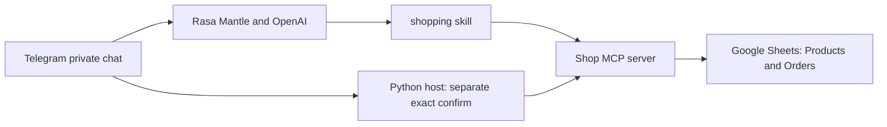

# Shop orders through Telegram and Google Sheets

This example lets one operator browse products, review a basket and place an
order in a private Telegram chat. Google Sheets holds the catalog and order
rows. Change an order's status to `shipped` in the Sheet to send a shipping
message to the same chat.

Google Sheets is the small ERP in this example: `Products` is its catalog and
`Orders` is its order book. Rasa handles the conversation. The model chooses
read and quote tools; Python checks confirmation before recording an order.



Author: Rasa Community contributors  
Assessed on: 2026-11-16  
Assessed by: Offline shop and consent checks; native processor and MCP protocol checks  
Verified with: rasa-pro 3.21.0.dev5 (synthetic controls; live order walkthrough incomplete)  
Industry: Retail  
You learn: How to review a Telegram basket, record it in Sheets and send a shipping message.  
Catalog name: Telegram shop assistant  
Status: work in progress

The **skill** is the shopping instructions and tools Rasa gives the model.
**MCP** connects those tools to the shop server. A **quote** is a basket review,
with a price and expiry; it is not an order yet. Replies return to the same chat.

Open a fresh Codespace from the **RasaHQ main** button below. Each reader runs
their own bot and dedicated Sheet.

<!-- codespaces:start -->
[](https://codespaces.new/RasaHQ/rasa-community-resources?ref=main&devcontainer_path=.devcontainer/examples-shop-assistant/devcontainer.json)

- **You need:** the free Rasa Developer Edition license and the keys it names: required `RASA_PRO_LICENSE`, `OPENAI_API_KEY`, `TELEGRAM_BOT_TOKEN`, `GOOGLE_CLIENT_SECRETS_JSON`, `GOOGLE_TOKEN_JSON`, `SHOP_SHEET_ID`, `SHOP_OPERATOR_CHAT_ID`, saved once as personal Codespaces secrets ([how](../../README.md#run-any-resource-in-a-github-codespace)). Use this button rather than the Codespaces picker, so you get this resource's setup.
- **Before the first command:** Create a blank demo Sheet and add the initial Codespace secrets. Google sign-in produces GOOGLE_TOKEN_JSON. All commands run in this Codespace terminal.
- **First command:** `make doctor`. The terminal opens in this folder, and the creation log ends with `READY`.
- **You should see:** setting names marked SET or MISSING or INVALID, with instructions for each missing value. Complete the named steps, rerun make doctor, then make setup-sheet and make run.
<!-- codespaces:end -->

**Work in progress:** the complete live order walkthrough has not passed.
The native and server environments pin the reviewed
[integration release](https://github.com/zeroemployeeorg/zeointegrations/commit/3a5c24db7111935b44e6fe6752ef57e1404debbc).
The server installs its Google extra; the native environment uses its direct
Telegram client. The two environments keep their MCP versions separate.

Rasa reads the shopping request and calls the read or quote tools. Python owns
the prices, confirmation and writes. The model has no order-placement tool.
A separate exact `confirm` reply places the reviewed basket. Any other reply
cancels that review. A changed request can produce a new review.

## See Rasa handle the message

At startup, the terminal names `MantleMessageProcessor` in the
`rasa.core.processor.create_message_processor` trace. This is the Rasa
component receiving each Telegram message through `Agent.handle_message`.
Its `shopping` skill gives the OpenAI model four tools. The model runs inside
Rasa and chooses among those tools.

When you ask for products, look for `mantle.tool.dispatched` with
`tool_name=product_catalog`. That native Rasa tool calls the catalog operation
through MCP, and the server reads the Products tab through zeointegrations.
The host displays the returned product data. For a basket, Rasa calls
`price_basket`; Python calculates the price and holds the review. A later
literal `confirm` is handled by the host before the Sheets write.

## Create a blank Sheet

Create a dedicated blank Google Sheet and keep its identifier from the URL.
You do not need to create tabs or paste rows. The setup command creates
missing tabs and seeds empty ones. Use this Sheet only for the example.

## Configure Codespace secrets

Use Python 3.12. Set these values through Codespace secrets, with access to
this repository. Stop and start the Codespace after adding secrets.

Open [personal Codespaces settings](https://github.com/settings/codespaces).
For each value below, choose **New secret**, enter its name and value, grant
`RasaHQ/rasa-community-resources` access, and save. Paste only the value, without
a name prefix or surrounding quotes. GitHub hides the saved values.

| Name | Value |
| --- | --- |
| `RASA_PRO_LICENSE` | Your Rasa license |
| `OPENAI_API_KEY` | Your OpenAI key |
| `TELEGRAM_BOT_TOKEN` | The bot token supplied by BotFather |
| `SHOP_OPERATOR_CHAT_ID` | Your positive private Telegram chat ID |
| `SHOP_SHEET_ID` | The identifier from the dedicated Sheet URL |
| `GOOGLE_CLIENT_SECRETS_JSON` | The complete Google Desktop OAuth client JSON, for consent only |
| `GOOGLE_TOKEN_JSON` | The authorized-user JSON returned by consent; required before setup and run |

## Telegram in 5 minutes

Run this in the Codespace terminal after `make setup`, with the assistant stopped:

```sh
make telegram
```

1. Open Telegram and search for the verified **@BotFather**. Tap **Start**,
   send `/newbot`, then choose a display name and a unique username ending in
   `bot`. Copy the token into the command's hidden prompt. If the token is
   already configured, the command asks whether to use it. It never displays it.
2. You should see `This is @yourbot` with that bot's Telegram link. Open that
   exact bot. A token from another bot means you would be listening elsewhere.
3. The command checks for a webhook. If one exists, it explains how to use a
   separate personal bot or ask its owner to remove the webhook. It changes
   no webhook. With no webhook, it asks you to stop other Codespaces using the
   same bot. It cannot prove that an idle remote reader is absent.
4. Send `/start` in a private chat with the named bot. The command waits up to
   90 seconds and then prints `Your private chat ID: ...`. Group messages and
   membership notices do not count. If several private chats are present,
   use a fresh personal bot. No message text or update offset is written.
5. Choose where the two settings live. For a live class, answer **yes** to open
   `shop-session>`. The token and chat setting exist in that child shell's
   memory. Run `make doctor`, `make status` or `make run` there. Type `exit` to
   leave it; your original terminal is unchanged. No credential file is saved.
   To keep the settings, answer **no**, then save `TELEGRAM_BOT_TOKEN` and
   `SHOP_OPERATOR_CHAT_ID` in [personal Codespaces secrets](https://github.com/settings/codespaces).
   Grant this repository access, then stop and start the Codespace.

A Make command cannot export values into the terminal that launched it.
The session shell avoids a restart for these two settings only. It inherits
other settings already available in that terminal; `make doctor` explains
what is still missing. GitHub Actions secrets are a different setting.

Use a separate bot for each Codespace. If another local command holds the
shop lock, stop it with Ctrl-C before setup. A Telegram conflict may mean a
remote reader; return to that command's terminal or use another personal bot.
The setup command never starts the assistant, sends a reply, or writes an order.

```sh
make status
```

Status shows the verified `@bot`, whether the private-chat setting is present,
and whether a local assistant holds the shop lock for those settings.
It checks Sheet access by reading metadata in the separate server environment.
It prints no settings values, rows or token. Status does not poll Telegram,
change webhook settings, create local state or set up the Sheet.
A configured chat setting alone does not prove that a message reached this bot.

`make chat-id` remains a shorter discovery command. It prints the bot name,
reads available private text messages and shows a single chat ID. Send `/start`
to the named bot and rerun it if no private message is available. It uses the
same local lock and leaves update offsets and conversation records unchanged.
Discovery explicitly includes text, edited text, membership and callback updates.
The running assistant uses the maintained client's explicit message/callback
selection on each poll. Edited text is supported for setup discovery only;
the current assistant does not treat an edit as a new order or confirmation.
A callback is retained as input; it grants no admin authority.
Your bot's ID or token is not your private chat ID.

Telegram documents [BotFather setup](https://core.telegram.org/bots/features#creating-a-new-bot)
and [polling versus webhooks](https://core.telegram.org/bots/api#getupdates).
GitHub explains [when new Codespaces secrets become available](https://docs.github.com/en/codespaces/managing-your-codespaces/managing-your-account-specific-secrets-for-github-codespaces).

Enable the Google Sheets API for the OAuth client project. If its consent
screen is in Testing, add your Google account as a test user. Use the Sheets
permission; the example needs no Drive-wide permission.

Google's [Sheets setup guide](https://developers.google.com/workspace/sheets/api/quickstart/python#authorize_credentials_for_a_desktop_application)
shows how to enable the API and create a **Desktop app** OAuth client. Copy
the complete downloaded client JSON into `GOOGLE_CLIENT_SECRETS_JSON`.
Use `make google-signin` below for this example's Codespace sign-in.

The sign-in command reads client JSON from the environment and keeps the token
in memory. It prints the authorized token for you to save as a Codespace
secret. It does not write client or token files.

## Sign in, set up the Sheet and start

In a fresh checkout, run `make setup` from this example's directory. It creates
three separate environments from their locks: native Rasa, the Core MCP server
and Google consent. On a second run, it reuses an existing environment when its recorded owner, project path and lock inputs match. It does not replace mismatched or unrecorded environments; preserve them and use a fresh Codespace. This reuse check does not audit every installed file. A Codespace
created from this example's launch button performs that setup during creation.

Run every command below in this example's Codespace terminal. Start with:

```sh
make
make setup
make doctor
```

Plain `make` only lists commands. `make doctor` makes no network calls or state
changes. It checks all seven setting names without printing values. Follow its
instructions for missing settings: create the Sheet and save its ID; use
`make telegram` for your bot and private chat; complete Google sign-in below.
The doctor may report the Google token missing until sign-in is complete.

First sign in:

```sh
make google-signin
```

Open the printed Google link in your browser and allow Sheets access.
Google redirects to `http://127.0.0.1:8766/`. Your browser should say it cannot
connect; that is expected. Copy the whole address from its address bar and
paste it at the `Address:` prompt in the Codespace terminal. Keep that address
private: it contains a one-time authorization code.

The command checks the redirect and sign-in state, then exchanges the code
using PKCE. It requires a refresh token and prints one token JSON line. Save
that line as `GOOGLE_TOKEN_JSON` in your personal Codespace secrets, grant it
access to this repository, and clear the terminal. Restart or rebuild the
Codespace so its processes receive the new secret.

Before that restart, a readiness message may name `GOOGLE_TOKEN_JSON` as
missing. Complete sign-in and save the token first. `READY` describes the
environment checks; the bot starts only when you run `make run`.

Then return to this example's Codespace terminal:

```sh
make doctor
make setup-sheet
make run
```

`make run` checks the doctor first and stops with instructions if a setting is
missing or invalid. Wait for the ready message before messaging the bot.

`make setup-sheet` uses the same Google token and `SHOP_SHEET_ID`. It creates
`Products` and `Orders` only when they are missing. In an empty Products tab,
it writes column names and these initial products:

| Code | Product | PriceCents | Stock |
| --- | --- | ---: | ---: |
| NOTEBOOK | Notebook | 12900 | 12 |
| MARKER | Marker | 4500 | 8 |

Prices use integer MXN cents. Stock is the initial quantity; recorded orders
reduce the available quantity. An empty Orders tab receives these columns:

```text
OrderNumber  QuoteJson  TotalCents  Currency  Status  CreatedUTC  RequestKey
```

Setup reads each whole tab. If it finds any returned row, it leaves that tab
unchanged and tells you. It appends only to empty tabs, using raw values.
It never clears or overwrites cells. Avoid editing the Sheet during setup.
If setup stops with an uncertain result, inspect the Sheet before repeating
it. Do not run two copies of setup or the assistant against the same Sheet.

## Walk through an order

1. Open the bot's private chat and send `/start` if Telegram requires it.
2. Ask, “What products are available?”
3. Ask, “I want two notebooks.” The review should show `MXN 258.00`.
4. Send `confirm` as a new message. Check that one row appears in `Orders`.
5. Ask, “What is my order's status?” It should report `placed`.
6. In the Sheet, change only that row's `Status` cell from `placed` to
   `shipped`. A shipping message should arrive in the same private chat.

Leave the order number, quote JSON, total, currency, date and request key
unchanged. The status edit represents an operator shipping action; it does
not contact a carrier.

A review expires after five minutes. An edited message, photo or unsupported
update cannot confirm it. A confirmation already waiting in the same fetched
batch cannot approve a prompt that the example sends later.

## State and stopping

The example retains incoming updates and send receipts in private SQLite
files under `.state`. It records an order intent before appending to Sheets.
A repeated request key reads the original order; it never appends again.

If a write or Telegram send has an uncertain result, the example stops and
keeps that record. Preserve `.state` and inspect the original result before
restarting. Deleting the journal removes the information needed to prevent
another write. Do not run two copies against the same Sheet.

Ctrl-C requests a clean stop after the current bounded operation. Repeating
Ctrl-C cannot skip closing the owned clients. A run stops after 30 retained
updates or 15 minutes, whichever comes first.

## Troubleshooting

| What you see | What to check |
| --- | --- |
| `MISSING or INVALID` from doctor | Save the named value in personal Codespaces secrets, grant this repository access, then stop and start the Codespace. GitHub Actions secrets are a different setting. |
| `TELEGRAM_BOT_TOKEN was rejected` | Copy only the bot token from BotFather, without labels or quotes. Save it again and restart the Codespace. Keep its value private. |
| Telegram rejects the token (401) | Copy the exact token from BotFather, then run `make telegram` or save it and restart the Codespace. |
| Telegram reports a conflict (409) | A webhook or another reader owns delivery. Follow the command's next step; use a separate personal bot or stop its other reader. |
| Telegram asks you to wait (429) | Wait a minute, then run `make telegram` again. |
| Telegram cannot connect | Check the Codespace network and token, then rerun setup. Preserve an uncertain order or send before restarting the assistant. |
| No reply in Telegram | Wait for the terminal's ready message, send `/start` to the intended bot, and check that `SHOP_OPERATOR_CHAT_ID` is your private chat ID. Run one assistant for this bot and Sheet. |
| The fallback repeats and the trace says `unexpected keyword argument 'context'` | Stop this old version and preserve `.state`. Use the reviewed fix from RasaHQ main: every native tool must accept the `ToolContext` Rasa supplies. This is a Python tool-signature error, not a different way to phrase the question. |
| The catalog check reports a missing `google_auth_oauthlib` | Use this example's locked development dependencies. `make test` runs in the consent environment; native catalog discovery also needs the declared OAuth test SDK. |
| Google sign-in or Sheet setup stops | Check that the Desktop OAuth client, Sheets API, token, and dedicated Sheet belong to the same demo setup. Inspect the Sheet before repeating a setup or write. |
| A review is no longer active | Ask for a new basket, wait for its review, then send a separate `confirm` within five minutes. |
| A write or send is uncertain | Stop and preserve `.state`. Inspect the original Sheet row or Telegram message before restarting; do not delete the journal or repeat the write. |

## Development checks

`make test-startup` uses fakes to check missing settings, chat-ID discovery,
safe failure hints and environment reuse. It makes no live calls.


`make test` checks the shop, durable conversation and Google sign-in helper
with synthetic provider responses. `make test-native` uses the actual locked
Rasa runtime and two MCP environments. It checks packaging, processor startup
and the protocol between the native client and Core server. It also checks
the installed Telegram client and Sheets SDK against synthetic responses,
including cancellation and raw cell appends. The startup fixture stubs
license validation and blocks network connections.

Catalog compatibility runs that native target too. Its locked server worker
is installed separately. The consent-only `make test` environment reports one
explicit skip for this native wrapper because it has no Rasa installation;
`make test-native` executes the native controls directly. The product-question
control passes “What products are available?” through the real Rasa processor,
shopping-skill activation and tool execution, using synthetic model responses
and a counted catalog client. It makes no provider request.

These checks do not prove Google consent, model behavior or Telegram delivery.
Complete the live walkthrough separately with the configured operator and
dedicated Sheet. This is a teaching shop with a single operator, not a
multi-user inventory system or a payment integration.
