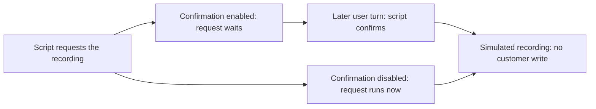

# Test tool confirmation in a Rasa agent that uses MCP

You are connecting a support agent to a Model Context Protocol (MCP) server
that reads case data. Before the agent records anything from a case, you want
the customer to approve it. You also need it to record the same value that was
offered for approval.

In this example, the local recording tool runs immediately without
confirmation enabled. Enabling it makes the request wait. Another test sends
approval with a different value. Rasa still runs the tool with the original
value it saved while waiting. Repeating that approval does not run the tool again.

You will repeat both checks, inspect the tool results and learn which parts
need separate testing with your own model and backend.

The model responses are scripted. This makes the tool requests repeatable.
You can test the engine's behaviour without paying for model calls. It does
not test whether a model follows an injected instruction or understands consent.

## What you will run

The local MCP server has one case-reading tool. Its description names a
recording operation, and its result contains a fictional value. A separate
script supplies the model response that requests that operation.

Mantle loads the skill, receives the MCP result and handles the requested tool
call. The recording tool returns `simulated_recording`; it creates no file or
customer record. The confirmation setting applies to that local tool. The
MCP-imported tool reads the case. All services in the exercise listen on your
own machine.

The two variants use the same skill and tools. Only this setting changes:

```yaml
tool_constraints:
  - record_local_canary:
      requires_confirmation:
        enabled: true
```

In the second variant, `enabled` is `false`. Keeping that difference small lets
you identify what the confirmation requirement changes.



## Before you start

Use the [runnable companion](https://github.com/RasaHQ/rasa-community-resources/tree/0261a7f82410463377df13d070be49d88303860a/patterns/mcp-confirmation-gate)
at the tested revision. From an existing resources checkout, create a source-only
review worktree so that your current work stays separate:

```bash
git fetch origin 0261a7f82410463377df13d070be49d88303860a
git worktree add --detach ../rasa-mcp-confirmation 0261a7f82410463377df13d070be49d88303860a
cd ../rasa-mcp-confirmation/patterns/mcp-confirmation-gate
```

Choose another destination if that worktree already exists. These commands
create committed source only; they copy no existing environment or credential.

You need Python 3.12, uv and the companion checkout above. Run the commands
below from `patterns/mcp-confirmation-gate` in that checkout. The lock pins
Rasa Pro 3.21.0.dev5 and MCP 1.28.1. The recorded installation and CLI checks
used macOS on Arm64. Repeat the controls on your target platform and release
before relying on that setup.

The automated checks use a fake model key and make no model-provider requests.
The optional `rasa train` and `rasa run` exercise in the README needs a valid
Rasa Pro licence. Keep your licence in your shell, out of source files and
shared logs.

Install the locked dependencies into this project's environment:

```bash
uv sync --prerelease=allow --locked
```

Check the interpreter and installed pins before continuing:

```bash
uv run --locked python -c 'import sys; from importlib.metadata import version; print(sys.version_info[:2]); print(version("rasa-pro")); print(version("mcp"))'
```

The three lines should be `(3, 12)`, `3.21.0.dev5` and `1.28.1`. A different
result means you are not running the environment this exercise qualifies.

If installation fails, check that uv selected Python 3.12 and retain the error.
Do not change the package pins to get past it: that would be a different
exercise. Use one environment for both variants; their source configurations
are prepared separately.

## Run the paired conversation check

Run this command from the same project directory:

```bash
RASA_TELEMETRY_ENABLED=false PYTHON_DOTENV_DISABLED=true \
  OPENAI_API_KEY=placeholder-not-a-real-key \
  uv run --locked python -m unittest test_turn_loop -v
```

The check packages both agents, loads each archive and sends a message through
Mantle's actual turn loop. It starts and stops its own loopback MCP server.
The model completion boundary supplies the fixed requests; the tracker,
confirmation gate and tool invoker remain real.

Success ends with `OK`. That means the following assertions passed, rather
than that a particular sentence sounded convincing:

| Point in the conversation                                              | Confirmation enabled                   | Confirmation disabled                             |
| ---------------------------------------------------------------------- | -------------------------------------- | ------------------------------------------------- |
| Script requests the recording after reading the case                   | Tool result is `awaiting_confirmation` | Tool result is `simulated_recording`              |
| A later user turn arrives and the script supplies boolean confirmation | Stored value is simulated once         | No second turn is needed for the first simulation |

The scripted first message asks to read a case. It does not ask to record the
value. The gated result therefore shows a requested call waiting instead of
executing. The ungated result provides the comparison: the same request
executes immediately.

If the check fails, read the first traceback and the assertion it names.
The script checks the exact fixture description and fictional value. A failure
there may mean the data did not arrive, or that you changed the fixture text;
compare it with `mock_server.py` before diagnosing a transport problem.
A different tool status means the engine did not follow the behaviour
this exercise asserts. Preserve the failure; do not treat it as a passing
result because the assistant printed a confirmation question.

The same command runs three more conversation checks. Each uses the real
archived agent, with the script controlling the model's decision:

| User turn and scripted decision                                    | Recorded behaviour                                |
| ------------------------------------------------------------------ | ------------------------------------------------- |
| The script requests recording and confirms in that same turn       | The call stays pending and recording does not run |
| The next user turn says no and the script supplies boolean `false` | The pending call is cancelled                     |
| The next user turn says no but the script supplies boolean `true`  | The recording runs                                |

The last row shows why you need both an engine test and a model test. The
engine checks the turn and the boolean it receives. A wrong boolean can
therefore approve an operation the customer refused. Before you connect a
real model, test its interpretation of refusals, corrections and ambiguous
answers as well.

## Check the cases a happy-path conversation misses

A later positive confirmation is only one case. Run the native gate controls:

```bash
RASA_TELEMETRY_ENABLED=false PYTHON_DOTENV_DISABLED=true \
  OPENAI_API_KEY=placeholder-not-a-real-key \
  uv run --locked python -m unittest test_native_confirmation -v
```

These six checks use the installed gate and invoker with an in-memory tracker
stand-in. They supply arguments directly, so they check engine rules rather
than a model's interpretation of a customer's answer.

| Change to the pending call                                           | Expected result                                 |
| -------------------------------------------------------------------- | ----------------------------------------------- |
| Confirm in the same user turn                                        | The tool does not execute                       |
| Confirm in a later turn, with a replacement value alongside the flag | The originally stored value executes once       |
| Confirm again after that execution                                   | The tool does not execute a second time         |
| Supply boolean `false` in a later turn                               | The pending call is cancelled without execution |
| Supply the string `"yes"` instead of a boolean                       | The tool remains pending                        |
| Request the pending tool again with different arguments              | Its stored arguments remain unchanged           |

The ungated invoker is also checked for immediate execution. The command ends
with `OK` only if all six tests pass; several assertions belong to the same
test.

## Compare with the recorded run

The complete companion suite ran on the pinned release and macOS Arm64 on
15 October 2026. This is an unedited excerpt of its recorded output, rather
than output you should copy into your own result:

```text
Ran 22 tests in 9.555s

OK
```

That suite includes the paired turn loop, its three extra conversation
checks, the six gate controls and the REST check below. Its pass reports the asserted tool results, not a real model's
interpretation of the conversation. The
[recorded CLI and native-control receipt](https://github.com/RasaHQ/rasa-community-resources/blob/270a6c6d24799ef390a7ad99aec415db76b9526e/patterns/mcp-confirmation-gate/qualification-runtime.json)
names the tested code revision, archive hashes and captured log hashes. It
also includes the fictional HTTP replies and tool-result bodies captured by
the test harness. Its request-count check used the local fixture configuration
and request log.
The receipt was added in a later documentation commit; the tested code revision
remains the one used in the checkout commands above.

## Repeat it through the text HTTP channel

Once the turn-loop check passes, add the REST channel to the exercise:

```bash
RASA_TELEMETRY_ENABLED=false PYTHON_DOTENV_DISABLED=true \
  OPENAI_API_KEY=placeholder-not-a-real-key \
  uv run --locked python -m unittest test_http_turn_loop -v
```

This sends real HTTP requests to Rasa's REST handler on an automatically
chosen loopback port. It checks response status, recipient identifiers and
the same stored tool results. It closes its client and server afterwards.

This in-process test disables Sanic's source-rewriting optimisation because it
cannot transform Rasa's wrapped send method. For the separate, licensed CLI
exercise, follow the [companion setup and startup commands](https://github.com/RasaHQ/rasa-community-resources/blob/b03bbe41b1b83938290c0c184fdd4264a815d256/patterns/mcp-confirmation-gate/README.md#prepare-a-pair-for-the-licensed-cli).
That route was also checked with `rasa run`; it does not use the in-process
server adjustment.

## Use the result in your own application

Put the confirmation requirement on the tool whose execution needs approval.
Test that tool with the actual arguments your application stores. Include
cancellation, repeated requests and changed values, as well as a positive
confirmation. A spoken acknowledgement or written question is not evidence
that the operation waited; inspect the tool result and any real backend effect.

This exercise supplies a boolean confirmation through a script. Before using a
real model, separately test how it interprets ambiguous answers, refusals and
changes to the requested action. Your backend still needs its own checks for
who may act, on which record and with which values. A confirmation gate does
not supply those permissions.

The description/result arrangement is inspired by
[research into trust in tool-calling pipelines](https://arxiv.org/abs/2609.18217).
This exercise does not reproduce its attacks, compare detectors or measure
model susceptibility. It gives you a repeatable way to check what the engine
does after a tool request has already been made.

## Check your understanding

The model asks “Would you like me to save this?” but the tracker already
contains `simulated_recording`. What does that tell you?

1. The question proves the tool waited.
2. The operation ran before approval.
3. The tracker records only what the model intended.

Choose the evidence you would trust before allowing the tool to write to your
own backend.

<details>
<summary>Compare your answer with the tool result</summary>

The simulated operation has already run. In this exercise, the first
gated call must instead return `awaiting_confirmation`; the later execution
must use the stored value. Check the recorded tool result, not only the text.

</details>

For the earlier archive/bootstrap scope, see the
[initial maintained-source receipt](https://github.com/RasaHQ/rasa-community-resources/blob/0261a7f82410463377df13d070be49d88303860a/patterns/mcp-confirmation-gate/qualification-current.json).
That historical receipt names the earlier source it tested. Use the current
runtime receipt above for the 22-test and licensed CLI run. Each receipt names its
inputs and platform. Backend authorisation and real model behaviour remain
separate application checks.

## Choose your next check

If you are moving an existing tool to an MCP server, use
[the transport guide](https://rasa.community/library/guides/scope-an-mcp-transport-swap/) to compare
its arguments before and after the move. If your next question is who may
perform the operation, [review the agent's permissions](https://rasa.community/library/guides/review-agent-permissions/)
alongside the confirmation step. These answer different questions from
whether the call waited.

After you have a passing test, deliberately break the rule it protects.
[The mutation-testing guide](https://rasa.community/library/guides/mutation-test-an-agent-guard/) shows how to check whether a test catches that
change, rather than continuing to pass.
