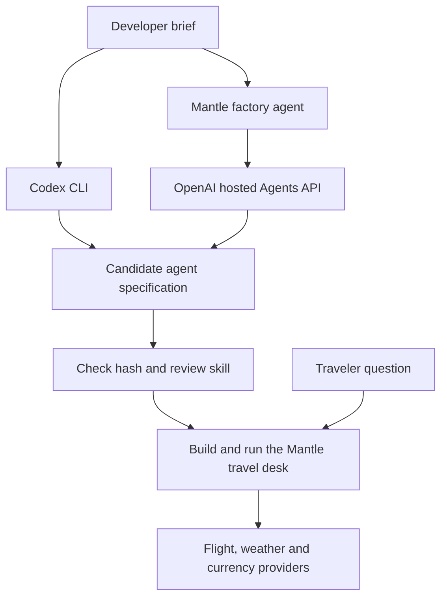

# Build a travel agent with Rasa Mantle and Codex

“I’m flying from Oslo to Bergen tonight. What other departures are scheduled? Will I need a coat when I land? How much is $200 in pounds?”

By the end you will have built a **traveler-facing Mantle agent** that calls public data services. You will also have used a different **Mantle factory agent** that takes a developer brief, asks permission to start an OpenAI hosted Agents API session and returns a candidate for another travel agent. You can inspect every tool call and run the resulting agent yourself.

```text
Industry:      General
You learn:     How to build a traveler-facing Mantle agent and use a factory agent that builds another one.
Catalog name:  Travel agent factory workshop with Codex
```

**Join the Rasa Community:** [rasa.community/join](https://rasa.community/join/)

**Printing for the room?** The one-page [printed setup sheet (PDF)](handout/rasa-travel-workshop-one-pager.pdf) walks a participant through steps A to D with a QR code for the Codespace.

## Before you start

You need a GitHub account with Codespaces access, a browser, a microphone, speakers or headphones, and the credentials below. A **Codespace** is your own temporary computer on GitHub. Its editor and terminal open in your browser. Your microphone and speakers stay on your device.

### A. Get the three values for the complete workshop

If the workshop host gave you a value, use it in the matching row. One Deepgram key serves **both** agents and both directions of audio. The Rasa value is a license. GitHub itself needs only your sign-in.

| Exact GitHub secret name | Where to get the value | What it unlocks |
| --- | --- | --- |
| `RASA_LICENSE` | Open the [Rasa Developer Edition request](https://rasa.community/#request-license), submit it and copy the full license string delivered to you. | Training and running the Mantle factory and traveler agents. |
| `OPENAI_API_KEY` | At a Rasa workshop the team hands out keys with AI credits; ask them. To use your own, open [OpenAI project API keys](https://platform.openai.com/api-keys), select the intended project, choose **Create new secret key**, name it and copy the value when shown. Use a project with billing and access to the configured models. | Mantle conversations, Codex API-key login, and hosted builds. The hosted exercise also needs Agents read/write and Responses write permissions. |
| `DEEPGRAM_API_KEY` | Open the [Deepgram Console](https://console.deepgram.com/), choose your project at the top left, then **Settings → API Keys → Create a New API Key**. Name it, choose a role that permits speech requests, create it and copy the secret while visible. Your project needs speech usage available. | Flux transcribes the user’s speech. Aura-2 speaks the reply. Both the developer and the traveler use this key. |

[Avinor](https://partner.avinor.no/en/services/flight-data/) supplies public airport boards. The flight exercise covers Oslo and Bergen in either direction. The weather tool uses Open-Meteo and the currency tool uses Frankfurter. The workshop endpoints require no additional participant keys. The [Avinor feed documentation](https://partner.avinor.no/en/services/flight-data/) describes the board and its update interval. The server reuses each board for three minutes within the running agent. For a commercial event, the organizer should check [Open-Meteo’s non-commercial free endpoint terms](https://open-meteo.com/en/terms) or provision appropriate access.

### B. Put the values in your personal GitHub settings

1. **Open two browser tabs.** Keep this guide open. In the other tab, [sign in to GitHub](https://github.com/login) with the account you will use for the workshop.
2. Click your **profile picture** at the top right, choose **Settings**, then choose **Codespaces** in the left sidebar. You can also [open that exact settings page](https://github.com/settings/codespaces).
3. Scroll to **Codespaces secrets** and click **New secret**. Think of a secret as a label paired with a hidden value.
4. Try the first one together. In **Name**, type `RASA_LICENSE`. In **Value**, paste the license string. Under **Repository access**, select **RasaHQ/rasa-community-resources**. Click **Add secret**.
5. Repeat step 4 for `OPENAI_API_KEY` and `DEEPGRAM_API_KEY`. Use each provider’s value in its own row. Confirm the names appear in the list. GitHub hides the saved values.
6. If a name already exists, edit its repository access to include the workshop. If the repository is absent from the picker, enter the value in the matching **recommended secret** field on the creation form in step C instead. For a fork, grant access to the fork you actually open.

Use personal **Codespaces secrets**. GitHub’s **Actions secrets** belong to a different feature. You do not need a local installation or a file containing these keys.

### C. Create your first Codespace

**[Open the travel factory in GitHub Codespaces](https://codespaces.new/RasaHQ/rasa-community-resources?ref=main&devcontainer_path=.devcontainer/travel-factory/devcontainer.json)**

1. On the form check the repository **RasaHQ/rasa-community-resources**, configuration **Rasa Travel Agent Factory**, and a machine with **at least four cores**. Check which account will pay for Codespaces usage. For an unmerged edition, use the review branch supplied by the host and choose **Code → Codespaces → New with options**.
2. Click **Create codespace** once. A browser editor opens. Leave it open while the preparation log runs. Wait for **Travel factory dependencies ready** before starting Mantle.
3. In the editor’s top menu, select **Terminal → New Terminal**. If the menu is collapsed, open **☰** first. The panel at the bottom is where you type commands. Paste the line below and press **Enter**.

```bash
bash desk doctor
```

**What you should see:** three secret names followed by `present`, the Mantle and builder executables marked `ready`, and a Codex executable path. This checks availability inside the workspace. The voice exercise below tests the microphone, speech services and speaker together.

**If a secret says missing:** return to step B, correct the name or repository access, then open [Your Codespaces](https://github.com/codespaces). Find this workspace, choose **… → Stop codespace**, wait for it to stop, then click its name to reopen it. Open a terminal and rerun `bash desk doctor`. Your existing project stays in place.

### D. Get a useful answer

In the browser editor choose **Terminal → New Terminal**. The terminal starts in `workshops/software-factories-masterclass`. Paste one command and press Enter:

```bash
bash desk data fx USD GBP 200
```

Find `converted` and `reference_date`. You can already tell a traveler approximately what $200 is worth in pounds and which day's rate you used. Try `bash desk data weather LHR` next. For flights, run `bash desk data flights OSL BGO` and use a returned flight number in `bash desk data status FLIGHT_NUMBER`. If a source is unavailable, keep that result and try the other one.

| Elapsed minutes | Open | What you finish with |
| --- | --- | --- |
| 0–30 | [Your first travel briefing](course/01-briefing.md) | A provider result, then a two-tool Mantle conversation |
| 30–75 | [Build the full agent with Codex](course/02-codex.md) | A separate four-tool Mantle project you can run |
| 75–85 | Break | Save the candidate path and your agent directory |
| 85–135 | [Operate the Mantle factory](course/03-factory.md) | A proposed agent specification, hosted session ID when live, and a reviewed build |
| 135–180 | [Test a complete trip and take it home](course/04-trip.md) | A flight briefing with attributable sources and a next build |

**Presenting?** Open the [slide PDF](slides/masterclass-slides.pdf) and [instructor card](FACILITATOR.md). Working alone? Each chapter ends with an observable checkpoint.

## How the two agents fit together



The build inputs are specifications. The output is a real agent directory you can open, edit, train and run. The live readers are reusable tools authored in the repository. Your builder decides how the travel skill should use them.

**Repeatable flight exercise.** Use the [two-date rehearsal](course/04-trip.md#run-the-two-date-case-on-your-own-agent) to test contradictory schedules with the same inputs on every run. `bash desk case status ZZ201` needs no credentials. Use the approval and Inspector steps to test the generated voice agent itself.
