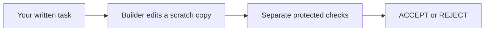

> **22 October revision:** Start with [the participant guide](../PARTICIPANT-GUIDE.md) for the three-hour route, current API distinctions, and platform requirements. These chapters are reference exercises; their checks do not certify the complete voice-to-build-to-voice journey.

# Chapter 5: Ask a builder to make the change

A traveler asks for a shorter currency list. The change looks small, but someone still has to write it and prove that the card respects the limit. Hand that request to a builder and keep the checks outside its reach.

Time: about 20 minutes after installation. You need: Python 3.12, [uv](https://docs.astral.sh/uv/), a clone of this repository and macOS for the network-blocking test. After installation you can do the exercise offline without a key. A paid model run is optional.

You're done when `ch05 OK` confirms that your chosen limit, the protected ACCEPT and the exported files agree.

If you get stuck, use [the ready folder](ready/ch05) and follow **Get the ready folder** below in a fresh work folder.

## Words used here

A **builder** proposes changed files. A **tool** is a function it may ask to run: here, list files, read a file or write a file. A **scratch copy** is a disposable copy of the product. The original product stays untouched. An **attempt** holds the proposed files.

The OpenAI Agents API runs a model session and its tool requests. **zeocore**, the Python package that holds the card code, connects the factory to that service. For this exercise, a **scripted stream** sends prepared file actions through the same connection.



The factory keeps the protected tests outside the scratch copy, where the builder cannot read them.

## Get the ready folder

Use a fresh work folder (`WORK` below), not an earlier exercise folder. Set `PACK` as in Chapter 0.

```bash
export PACK=~/rasa-community-resources/workshops/software-factories-masterclass   # after a clone
# after unzipping, use this line instead: export PACK=/path/to/the/unzipped/software-factories-masterclass
export WORK=~/factory-work/my-factory-ch05
if [ -e "$WORK" ]; then
  printf '%s\n' 'Refused: that folder already exists. Choose a fresh WORK name.'
else
  mkdir -p ~/factory-work &&
  cp -R "$PACK/book/ready/ch05" "$WORK" &&
  cd "$WORK" &&
  uv venv --python 3.12 .venv &&
  . .venv/bin/activate &&
  uv pip install -r requirements.txt
fi
```

The refusal leaves your current directory and earlier work unchanged; it does not
run setup inside the old folder or close your terminal. If it refuses, edit the
`WORK` line to a fresh name and repeat the whole block. The installation downloads
the pinned dependencies once; it does not read a license or an API key.

## See how it works

1. Ask the supplied offline builder to make the initial two-currency card:

   ```bash
   python build.py tasks/b-limit-currencies.json attempts/see --scripted
   ```

   You see `ACCEPT; exported checked files to attempts/see`, followed by `SCRIPTED; zero provider calls`. The protected tests really ran. The files came from a teaching script, not a model.

2. Open the evidence page in another terminal, with the same `WORK` folder:

   Set the folder again: a new terminal does not inherit `WORK`. If you chose a
   different name during setup, use that same name here.

   ```bash
   export WORK=~/factory-work/my-factory-ch05
   cd "$WORK"
   .venv/bin/python factory_engine/factory_console.py runs/see/run --port 8943
   ```

   Visit [the local factory page](http://127.0.0.1:8943/). It shows the task, file actions, diff, protected result and decision. Use **Pause automatic refresh** to read. This is a read-only page: start the builder with the terminal command, not a Run button. If port 8943 is already occupied, choose `--port 8945` and open that port instead. Stop your own viewer with Ctrl-C when finished.

3. Read these two files in your editor:

   - `build.py` prepares the run, asks the builder and exports files only after ACCEPT.
   - `factory_engine/agent-runs/drivers/openai_factory_driver.py` registers three confined file tools and stops an incomplete session before any ACCEPT decision.

   The separate tests live under `acceptance/`. They remain on the factory side, outside the builder's scratch copy.

## Now change it

You choose the requirement. The builder writes the product code.

1. Change the public task's `limit` from 2 to **1 or 3**. This example asks for three currencies:

   ```bash
   python - <<'PY'
   import json
   from pathlib import Path
   path = Path('tasks/b-limit-currencies.json')
   task = json.loads(path.read_text())
   task['limit'] = 3
   path.write_text(json.dumps(task, indent=2) + '\n')
   PY
   ```

   The builder receives that limit with the written request. It receives no protected test paths or fingerprints. The verifier uses its own exact task copy, so it judges the same limit.

2. Ask for a fresh attempt:

   ```bash
   python build.py tasks/b-limit-currencies.json attempts/mine --scripted
   ```

   You see ACCEPT and the explicit SCRIPTED label. The exported files are in `attempts/mine`; the original `product/` remains the baseline. To inspect this run in the viewer, stop your viewer and start it with `runs/mine/run` instead of `runs/see/run`.

3. Check the exact exported files:

   ```bash
   python check_build.py attempts/mine
   ```

   You see a line starting `ch05 OK`. Changing an exported file afterward makes this check fail. That is useful: a checked change and a later edited change are different things.

## You are done when

From `WORK`, with its environment active:

```bash
python check_build.py attempts/mine
```

This must exit 0 and print `ch05 OK`: your chosen limit, a completed builder session, protected ACCEPT and the exact exported files all agree. It fails in the ready folder before your change. Use this check before carrying the attempt into another exercise.

To continue with the same chosen limit, use the later chapter's `set_limit.py N`,
with your number in place of `N`. It keeps that chapter's protected-test pins and
makes a compatible offline attempt. To carry this exact checked attempt instead,
copy **both** `tasks/b-limit-currencies.json` and `attempts/mine` into the later
ready folder after its setup and before its **See how it works** steps. Start with
a fresh destination for the attempt; do not merge it into another attempt. If the
protected-test fingerprints differ, use the later ready folder and regenerate
there. Never edit protected tests to force a match. Do not copy credentials,
`runs/` or the virtual environment.

## Optional: ask a model to make the change

The scripted result above does not test a model. To use the real API, you need your own `OPENAI_API_KEY` in the builder process environment. Never put its value on a command line, in this task or in a committed file.

There is **no per-session money cap**. The provider rejected the `spend_control` field in a bounded run on 22 October 2026, so the driver sends no such field. An account owner can configure an **enforced hard project or organization spend limit**. A budget alert alone does not stop requests. Enforcement can lag slightly, so recorded spend may exceed the configured amount. See the [official spend-limit guide](https://developers.openai.com/api/docs/guides/spend-limits). No account settings have been inspected by this chapter. The builder is locally bounded to 30 tool calls, a 120-second deadline, a 20-second transport timeout, one named model and no retry loop. These bounds limit execution; they do not guarantee a monetary ceiling.

Before a paid run, check your account budget and state an expected cost range from the model's current price and your planned usage. No measured live price is supplied by this offline exercise. Enter the model and your expected range in cents; these prompts never ask for a key:

```bash
printf 'Model approved for your Agents session: '; IFS= read -r MODEL
printf 'Expected lower cost, USD cents: '; IFS= read -r MIN
printf 'Expected upper cost, USD cents: '; IFS= read -r MAX
python build.py tasks/b-limit-currencies.json attempts/funded --live \
  --model "$MODEL" --expected-cost-cents-min "$MIN" --expected-cost-cents-max "$MAX"
```

Inspect the resulting native status, file actions and protected decision. Then inspect actual usage on the provider's account page. Run at most three paid builds in a practice session, recording each outcome and actual cost. If a session fails, becomes incomplete or hits a limit, it cannot produce ACCEPT. Preserve the evidence and use the offline path; do not run a retry loop.

## If it fails

- **Choose a new attempt name:** the factory preserves earlier runs. Use a fresh name rather than deleting evidence.
- **No module named zeo_core or openai:** activate this chapter's environment and repeat its pinned installation.
- **Protected tests cannot run:** missing macOS sandbox support prints `could not run: this check needs macOS` and exits 2 before a model request or test. Pair with someone on a Mac or follow along on screen. Check Python setup too. A setup failure is not ACCEPT or evidence that the requested change is wrong.
- **The live session could not complete:** inspect its fixed status/error record under `runs/NAME/run/native.json`; no raw provider body is displayed. Use the scripted exercise while resolving the API or account restriction.
- **The exported files differ:** do not patch them by hand. Make a new task/attempt and let the builder and gates decide again.

## Good to know

The scripted stream makes no model request. It shows the file tools and checks, rather than measuring a model's ability. A successful file-tool call still needs a protected ACCEPT, and this exercise exports files without restarting the product.

## What you just learned

You asked a builder for a currency limit and checked the files it produced against that request. Keep the task with those files so the next exercise can judge the same change.

Next: [judge the attempt](06-the-gates-and-the-decision.md).
