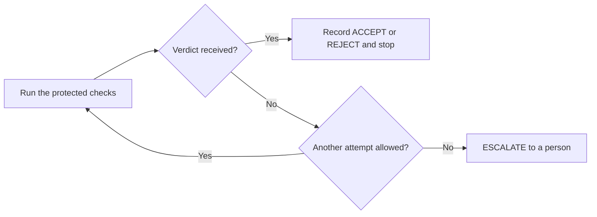

# Chapter 8: Measure results and recover without guessing

**Goal:** ask the factory to change its retry allowance, then observe a checked change, a bounded recovery and an honest report.

**You need first:** Python 3.12, [uv](https://docs.astral.sh/uv/) and a clone of this repository. This chapter includes its complete code. It uses only Python's standard library: no model, account, licence or network request is needed after Python is installed. The earlier chapters explain the builder and the protected checks; you can run this checkpoint on its own.

## What happens after a run fails?

A **verdict** says whether a proposed change meets the requirements. ACCEPT means it does; REJECT means it does not. A **crash** or **timeout** produces no verdict. Retrying a crash can help. Repeating a rejected change does not fix it and can reveal information about the protected tests.

An **escalation** stops the automatic loop and asks a person to investigate. A **ledger** is the local file that remembers the attempts and their outcome. This chapter allows one process to write that file at a time.



The exercise changes a small JSON configuration. It does not change the earlier market card or restart your agent. Keeping this request small lets you see the recovery rule without paying for more builder calls.

## Get the ready folder

Set `REPO` to your clone. Run the whole block from a terminal:

```bash
export REPO=~/rasa-community-resources
export WORK=~/factory-work/my-factory-ch08
if [ -e "$WORK" ]; then
  printf '%s\n' 'Refused: that folder already exists. Choose a fresh WORK name.'
else
  mkdir -p ~/factory-work &&
  cp -R "$REPO/workshops/software-factories-masterclass/book/ready/ch08" "$WORK" &&
  cd "$WORK" &&
  uv venv --python 3.12 .venv &&
  . .venv/bin/activate
fi
```

If the folder exists, choose a new `WORK` name and repeat the block. Earlier evidence stays intact. There is no package installation command: this checkpoint has no third-party dependencies. Python 3.12 is the tested runtime; other versions return NOT_READY when the verifier checks the environment.

## See how it works

1. Run the supplied configuration builder and the real protected checks:

   ```bash
   python lesson.py see
   ```

   You see `SCRIPTED teaching builder` and ACCEPT. This builder writes a known proposal with two attempts. It makes zero model calls. ACCEPT comes from the separate verifier, which reads the JSON and runs four protected tests. It is not a scripted success message.

2. Read these three files:

   - `tasks/c-recovery-attempts.json` asks for an attempt count and permits only `product/recovery.json` to change.
   - `acceptance/c_recovery_policy.py` checks the count, the exact fields and the rule that REJECT is never retried.
   - `recover.py` records a crash, retries within the chosen allowance and stops on a verdict or escalation.

   The builder receives the public request; it does not read the protected tests. The verifier uses the same factory engine introduced earlier, with a data-only profile. It never imports or executes the proposed configuration. This is different from earlier chapters' Python product tests, which require the macOS sandbox. Only the data-only profile is exercised here; it is not permission to run untrusted Python without that sandbox.

## Now change it

You choose a requirement. The supplied builder changes the JSON; you do not edit that product file by hand.

1. Choose **1 or 3 total attempts**. Three permits a retry after the controlled first crash:

   ```bash
   python set_request.py 3
   python lesson.py build
   ```

   You see ACCEPT for your request. `attempts/mine/product/recovery.json` contains the checked proposal. The original configuration still allows two attempts. Choosing 1 is also valid; its expected recovery outcome is ESCALATE rather than ACCEPT.

2. Measure two deliberately chosen teaching cases:

   ```bash
   python lesson.py measure
   ```

   The verifier rejects the original two-attempt configuration against your new requirement. The report counts one accepted proposal and one rejected baseline. It explicitly labels them **CONTROLLED teaching cases** and leaves missing time and cost unreported.

   These two outcomes are not a model success rate. We selected them to show both verdicts; repeating them does not create independent evidence. For a real comparison, decide the task set, environment, model settings, budget and scoring rules before running; retain failures and incomplete runs as well as successes. Record measured usage and time. Run the same tasks under comparable conditions and get someone independent to check the scoring. Passing these requirements still does not prove that users will find the product useful.

3. Run a controlled recovery exercise:

   ```bash
   python lesson.py recover
   ```

   With 3 attempts allowed, the first attempt is deliberately marked CRASHED before any test starts. The second executes the real protected checks and records ACCEPT. You see two attempts executed. With 1 allowed, the first crash exhausts the allowance: you see ESCALATE and exit code 4. That is the intended outcome for that request, not a failed exercise.

4. Repeat that command:

   ```bash
   python lesson.py recover
   ```

   You see `DUPLICATE`, the stored outcome and `Recovery attempts executed in this invocation: 0`. The ledger remembers ACCEPT, REJECT and ESCALATE for the same work. A changed task, proposal, baseline, verifier, test suite or runtime is different work.

   Keep the ledger and run folders. This is a single-process teaching example, not a production job queue. It does not promise exactly-once execution: a process killed after doing work but before saving could repeat that work. Real deployments also need coordination between workers and safe handling of external effects such as sending a payment.

## You are done when

```bash
python lesson.py check
```

This exits 0 and prints `ch08 OK`: your proposal received protected ACCEPT, the baseline received REJECT and recovery ended as required by your choice. The command fails before the exercise or if the checked proposal changes afterward. With a one-attempt request, its success includes the expected ESCALATE outcome.

## Where a person still decides

Automation does not give the proposer permission to weaken its own checks. `policy.json` lists protected paths, and `policy.py` illustrates how a proposal touching those paths is sent for independent review. These files explain the supervision policy; they are not an access-control boundary.

You can also inspect a hypothetical supervision calculation:

```bash
python policy.py what-if policy.json 12 12
```

It starts `WHAT-IF`: no experiment records were loaded. Even twelve perfect trials would leave uncertainty about future failures. The calculation uses a **Wilson interval**, a range that reflects sampling uncertainty under assumptions about independent, comparable trials. It cannot repair a biased or selected sample. The policy therefore holds at its initial supervision level in this example. Eligibility under a larger hypothetical count still requires a person to sign a policy change; this command changes no policy.

## If it fails

- **NOT_READY:** use Python 3.12. A setup problem is not a verdict on the change.
- **An attempt or measurement folder already exists:** keep it and start the chapter in a fresh `WORK` folder. Do not erase evidence to obtain a cleaner result.
- **ESCALATE with one attempt:** that is expected. Run the completion check. To explore three attempts, start a fresh folder and request 3.
- **A proposal changed after ACCEPT:** let the builder make a fresh proposal in a fresh exercise folder. Do not edit the protected tests or ledger to make the completion check pass.
- **You want a real timeout test:** the controlled classroom fault is a crash, not a measured timeout. `recover.py` also bounds the verifier subprocess by a deadline; that mechanism needs separate platform testing before deployment.

You now have a visible distinction between a wrong change, an unavailable verdict and work that needs a person's decision. Keep that distinction when you connect the factory to a real product.
